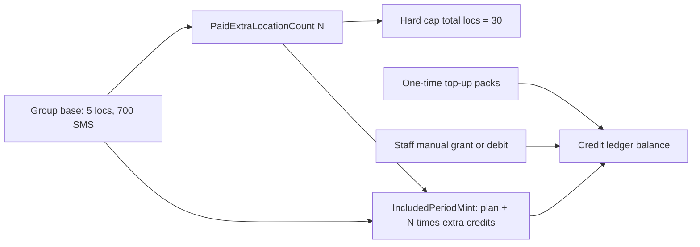
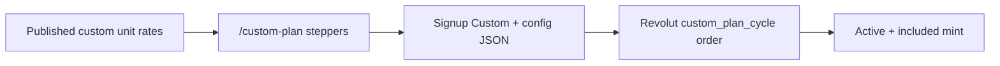

# Group custom plan support

**Status:** Admin commercial catalog **Shipped**; Custom acquire + renew + VAT + cancel + Manage plan **Shipped**  
**Last reviewed:** 2026-10-20  
**Audience:** Product, billing engineering, support

Capability note: fixed Group extras versus the self-serve **Custom** plan (à-la-carte locations and independent monthly AI / SMS / Email included credits).

Commercial numbers for catalog plans come from the Admin-published commercial catalog (seeded from the approved UK pack). Runtime caps and flows are verified against the codebase.

## Status summary

| Capability | Status |
|------------|--------|
| Fixed Group plan SKU (Starter / Growth / Group catalog) | Shipped — Admin Billing catalog |
| Extra Group locations (paid add-on, self-serve) | Shipped — max **30** total locations |
| Included monthly credits from plan + per-extra-location formula | Shipped (Group path) |
| One-time credit top-up packs | Shipped — Admin Billing catalog |
| Custom plan: locations to **500** | Shipped — `LocationCap.CustomMax` |
| Custom plan: independent recurring AI / SMS / Email included allotments | Shipped — snapshot on billing account |
| Recurring charge via Revolut cycle order (snapshotted period amount) | Shipped — acquire + renewal job |
| VAT on Custom cycle (`TUMMLY_VAT_MODE_ACTIVE`) + VAT invoice / activity | Shipped |
| Unpaid renewal soft-lock via dunning episode | Shipped |
| Cancel at period end → Pilot SoftLock | Shipped — same post-cancel path as catalog |
| Manage plan Custom panel (summary, resume pay, cancel) | Shipped |
| Mid-contract edit / re-quote of custom quantities | Planned — follow-up |

## Domain terms

| Term | Definition |
|------|------------|
| **Group plan** | Paid catalog plan with 5 included locations and fixed monthly credit pools |
| **Paid extra location** | Count on the billing account; each unit raises location entitlement by 1 (and users / monthly credits by the add-on formula), up to the self-serve max |
| **Included period mint** | Ledger grant of plan monthly credits (plus extras, or Custom snapshot quantities) for the current paid period |
| **Top-up** | One-time credit pack purchase; not a change to the plan’s included monthly allotment |
| **Custom plan** | À-la-carte `SubscriptionPlan = Custom`: configured locations (1–500), team users, QR, Offers, Email / SMS / AI monthly credits; billed by Revolut **cycle order** from a rate snapshot |

## Verdict

**Group** remains a fixed catalog SKU plus extra-location add-ons (cap 30).

**Custom v2 (2026-10-20):** base package (Starter / Growth / Group, picked by Location count; customer may keep a higher one) + fixed add-on packs (+5 team users, +5 Offers, +10 QR placements account-wide, Email 20k / 50k, SMS 500 / 1,000 / 5,000, AI 500 / 2,000). Server re-prices every config (`CustomPlanQuoteService`, `POST /api/public/commercial-catalog/custom-plan/quote`); no packs and Locations within the base → plain catalog plan. Signup: account → business → first Location → choose / customise plan → review → Revolut → `/signup/complete` (one-time `POST /api/Signup/session-login`) → `/signup/locations` → WebApp. Free default removed from self-serve signup. Spec: `.scratch/signup-plan-customise/`.

**Custom (v1, à-la-carte, superseded)** was a separate self-serve path: Pricing “Customise your plan” → `/custom-plan` unit steppers → signup with config snapshot → Revolut cycle order → Active + included mint. Renewals open a new cycle order at `RenewalDateUtc` (hourly job); unpaid cycles start a dunning episode and soft-lock on the same clock as catalog. Cancel at period end demotes to Pilot SoftLock. Unit rates are Admin-editable on the published commercial catalog. Mid-period Admin rate edits do not change an active contract until re-quote (snapshot wins).

## Catalog baseline

Runtime source of truth: Admin-published `CommercialCatalogVersion` via `DbPricebookCatalog` (ADR 0048). Seed / history: [`billing-pack-v3.0/tummly_uk_billing_config_v3.0.json`](./billing-pack-v3.0/tummly_uk_billing_config_v3.0.json).

| Entitlement | Group base | Extra location add-on | Custom |
|-------------|------------|------------------------|--------|
| Locations | 5 included; self-serve max **30** | +1 per unit | Configured 1–**500** |
| Users | 25 | +2 per unit | Configured |
| Monthly AI / Email / SMS | Fixed pools + per-extra formula | Formula | Independent configured allotments |
| Price | Catalog plan row | Catalog extra-location row | Sum of Admin custom unit rates (annual uses each row’s AnnualNetPence; if empty, that row falls back to monthly × 12 × 0.85) |

## How Group extras and credits work

### Extra locations (Group only)

- Owner can add or remove extras on Manage plan (`ManagePlanGroupActionsSection`).
- Stored as `BillingAccount.PaidExtraLocationCount`.
- Entitlement: `included + extras`, capped at 30 (`LocationCap.TryResolve` for plan key `group`).
- Add is paid via Revolut (`extra_location` order intent); remove schedules at renewal.

### Included monthly credits (Group)

`IncludedPeriodMintService` resolves channel quantities as:

`plan.credits_monthly + PaidExtraLocationCount × credits_monthly_added`

### Custom plan acquire path

- Config + rate snapshot on `BillingAccount.CustomPlanConfigJson` / `PendingSignup.CustomPlanConfigJson`.
- Checkout: `CustomPlanCycleBillingService.StartCyclePayAsync` (net = snapshotted `periodNetPence`; VAT from `TUMMLY_VAT_MODE_ACTIVE`); webhook: `RevolutOrderCompletedApplier` purpose `custom_plan_cycle` (mint + VAT invoice + activity; clears dunning).
- Renewal: `CustomPlanCycleRenewalJob` (hourly) opens/reuses cycle order, starts dunning, ticks soft-lock.
- Cancel: Owner Manage plan `cancel-plan` sets `ScheduledCancelPlan`; included-period job applies `ApplyPostCancelSoftLock` (Pilot SoftLock; clears Custom config).
- Manage plan: Custom current-plan summary, resume cycle pay (`POST /api/billing-credits/custom-plan/cycle-pay`), catalog cards disabled until Custom is cancelled.
- Signup retry: provisioning status `PaymentRedirectUrl` resolves open `custom_plan_cycle` intents.

## Primary sources

| Claim | Source |
|-------|--------|
| Commercial catalog Admin + DB runtime | ADR 0048; `DbPricebookCatalog`; Admin Billing catalog panel |
| Group prices / seed history | `docs/product/billing-pack-v3.0/tummly_uk_billing_config_v3.0.json` |
| Custom location max 500 | `LocationCap.CustomMax`; `CustomPlanConfig.MaxLocations` |
| Custom cycle order | `CustomPlanCycleBillingService`; `RevolutOrderIntentPurposes.CustomPlanCycle` |
| Custom renewal + dunning | `CustomPlanCycleRenewalJob`; `BillingAccountLifecycleService` |
| Marketing configurator | `PricingCustomisePlanSection`; `CustomPlanPage` |
| Plan keys include Custom | `BillingSubscriptionPlans.Custom` |
